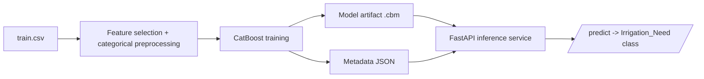

# Kaggle Playground Series S6E4 - From Competition Model to Deployable API

This repository demonstrates a full path from **Kaggle tabular modeling** to a **production-style inference service**.

## What this project proves

1. Competitive ML workflow for `playground-series-s6e4` (Predicting Irrigation Need).
2. Reproducible training pipeline with configurable compute budgets.
3. Deployable serving layer (FastAPI + Docker), not just notebook experimentation.

## Repository structure

- `kaggle_gpu_submission_workflow.ipynb`  
  Kaggle Notebook workflow to train/evaluate and generate `submission_ready.csv`.

- `train_advanced_and_submit.py`  
  Advanced competition trainer (CatBoost + CV + optional search + report JSON).

- `kaggle_submission_guide.md`  
  Step-by-step notebook submission guide.

- `train_api_model.py`  
  Trains a CPU CatBoost model and exports serving artifacts to `model_artifacts/`.

- `app/main.py`  
  FastAPI service with:
  - `GET /health`
  - `GET /schema`
  - `POST /predict`

- `Dockerfile` + `requirements.txt`  
  Containerized API deployment stack.

## Architecture



## Kaggle workflow

1. Open the competition notebook environment.
2. Run `kaggle_gpu_submission_workflow.ipynb`.
3. Produce:
   - `/kaggle/working/submission_ready.csv`
   - `/kaggle/working/model_report.json`
4. Submit in competition UI.

## API training and local serving

### 1) Install dependencies

```bash
pip install -r requirements.txt
```

### 2) Train and export API artifacts

```bash
python train_api_model.py --data-dir . --output-dir model_artifacts --iterations 700 --seed 42
```

### 3) Run FastAPI

```bash
uvicorn app.main:app --host 0.0.0.0 --port 8000
```

### 4) Test endpoints

```bash
curl http://127.0.0.1:8000/health
curl http://127.0.0.1:8000/schema
```

## Docker deployment

Build image (after generating `model_artifacts/`):

```bash
docker build -t irrigation-api:latest .
```

Run container:

```bash
docker run --rm -p 8000:8000 irrigation-api:latest
```

## Business framing

This repo is designed as a public proof asset for ML/Data Engineering work:

- measurable leaderboard performance
- reproducible experiments
- deployable inference interface
- clear operational documentation
